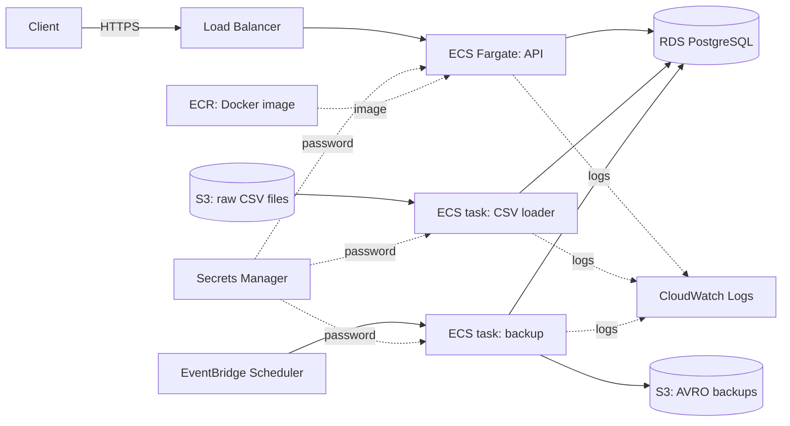

# AWS Architecture

How this project would run on AWS. This is a design, not a deployment. The
idea is to keep the same Docker image and the same code, and to replace the
local pieces with AWS services.

## Diagram

## Services

| Local piece | AWS service | Why |
| --- | --- | --- |
| `$DATAWORK_DIR/raw/` | **S3** | Safe storage for the raw files. Versioning keeps every version of each file. |
| PostgreSQL | **RDS for PostgreSQL** | AWS manages the database server: automatic backups, and minor version updates in a maintenance window. |
| Docker image | **ECR** | A private place to store the image built from the `Dockerfile`. |
| API | **ECS on Fargate**, behind a **Load Balancer** | Runs the same container, with no servers to manage. The load balancer adds HTTPS and checks that the API is working. |
| CSV loader | **ECS task**, run once | The same image with a different command, like `docker compose run loader`. |
| AVRO backups | **ECS task** started by **EventBridge Scheduler**, saving files in **S3** | Backups run on a schedule, and the files are stored outside the database. |
| AVRO restore | **ECS task**, run by hand | A restore replaces a whole table, so a person decides when to run it. |
| `.env` and `~/.pgpass` | **Secrets Manager** | ECS gives the password to the container as `PGPASSWORD`. The code already reads this variable, so it does not change. |
| Terminal output | **CloudWatch Logs** | All the logs from the API, the loader and the backups in one place. |

## Network and security

- The database and the containers are in a **private network**. Only the load
  balancer can be reached from the internet.
- **Firewall rules (security groups):** the database only accepts connections
  from the containers, and the containers only accept traffic from the load
  balancer.
- **VPC endpoints** let the containers reach S3, ECR, Secrets Manager and
  CloudWatch without going through the internet.
- **Permissions (IAM roles):** each task has only the permissions it needs. For
  example, the loader can read the raw files, and the backup task can write
  backups.
- **Encryption:** the data in the database and in S3 is encrypted, and the API
  uses HTTPS.
- The API still needs **authentication**, for example an API key.

## Code changes needed

- **Loader:** read the CSV files from S3 instead of the local disk.
- **Backup and restore:** save and read the AVRO files in S3 instead of a local
  folder.
- **Configuration:** no change. The file locations and the database connection
  already come from environment variables.

## Other options

| Option | Why not, for now |
| --- | --- |
| **EC2 with Docker Compose** | The easiest to set up, but someone has to update and watch the server. Good for a quick demo. |
| **Lambda + API Gateway** | No servers and you pay per request. But each Lambda instance opens its own database connection, so many requests at the same time can use up the database connections (RDS Proxy helps with this). Also, a Lambda function cannot run more than 15 minutes, so a long load does not fit. |
| **App Runner** | Very easy for the API, but the loader and the backups would still need another service. |

## Larger volumes

This design is enough for the current data. For millions of rows:

- **Load with `COPY`** into a temporary table, then check the rows and move
  them with SQL, all at once instead of row by row.
- **AWS Glue** (Spark jobs) to check and transform large files in parallel, and
  save them as Parquet files in S3.
- **Athena** to query the files in S3 directly, or **Redshift** if the analytics
  grow too big for PostgreSQL.

## Main costs

The load balancer, the database and the containers are the main monthly costs.
The other cost is how the containers reach AWS services: a NAT Gateway, or VPC
endpoints. The S3 endpoint is free. The other endpoints are paid by the hour,
so for a small setup their cost is close to a NAT Gateway, but the traffic
stays inside AWS. A budget alert in AWS Budgets is part of the setup.
